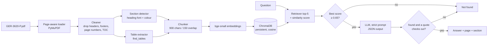

# Gas Turbine Maintenance Assistant

A RAG assistant that answers questions about GE GER-3620 Rev P, *Heavy-Duty Gas Turbine Operating and Maintenance Considerations*, citing the page and section for every answer, and replying exactly `Not found` when the document does not contain the answer.

Stack: Python · PyMuPDF · LangChain · ChromaDB · BAAI/bge-small-en-v1.5 (local embeddings) · Google Gemini or Groq · FastAPI · Three.js

## How it works



1. **Loader** (`app/ingest.py`): PyMuPDF reads every page and keeps the **PDF viewer page number** (1–60). This is the number the cited link `/pdf#page=N` opens. The printed page number in the PDF footer is 4 lower, e.g. printed "21" is viewer page 25.
2. **Cleaner**: drops the running header and footer by position (`Doc Name : GER-3620…`, `Non-Public…`, page numbers), the table-of-contents pages and the *List of Figures*. Chart tick labels (small text with almost no letters) are removed too.
3. **Section detector**: in this PDF, headings are the only lines printed in the accent colour (`#006061`) at 10 pt (subsection) or 14 pt (section). Two-line headings are merged, and the current section carries over page breaks.
4. **Tables**: `page.find_tables()` finds tables. A table is kept only when it has at least 3 rows, at least 3 columns and at least 45% of cells filled, because charts are also detected as "tables" but are mostly empty. Each row is rewritten so every value keeps its labels, e.g. `Combustion (DLN) — 7E. 03 (6): 12000/450 …`. A table's section is the section whose text last mentions its figure number, e.g. Figure 36 → *Inspection Intervals*.
5. **Chunker**: `RecursiveCharacterTextSplitter`, 900 characters with 150 overlap, split per page and per section so each chunk has one page and one section. Each chunk starts with `[Section | page N]` so the embedding also sees the section name.
6. **Store**: ChromaDB with cosine distance in `./chroma_db`. Ingestion deletes and rebuilds the collection using fixed chunk ids, so re-running it never creates duplicates.
7. **Answer** (`app/rag.py`): the steps below.

## How "Not found" works

Three independent layers, so no single component has to be perfect:

| Layer | What it does | Why |
|---|---|---|
| 1. Relevance gate | If the best cosine similarity of the top-5 chunks is below **0.65**, return `Not found` without calling the LLM. | Clearly off-topic questions (titanium, CEO of GE, boiling point of water) never reach the LLM, so it cannot answer them from general knowledge. |
| 2. Strict grounded prompt | The LLM may use only the retrieved context and must return structured JSON `{found, answer, citations[{page, section, quote}]}` (LangChain `with_structured_output` + Pydantic). | Catches questions that *sound* on-topic but aren't answered, e.g. "purchase price" passes the gate (0.682) because it is close to "purchase these spare parts". |
| 3. Citation check | Every `quote` must appear word for word (after normalising case, whitespace, quotes and dashes) in a retrieved chunk of the cited page. The section label shown to the user is taken from that chunk's metadata, not from the LLM. If no citation checks out → `Not found`. | Stops made-up answers and made-up page numbers. |

**Threshold choice (0.65):** the answerable questions scored 0.726–0.819 and the out-of-document controls scored 0.44–0.62 (titanium 0.576, CEO of GE 0.569, boiling point of water 0.621, capital of France 0.439). 0.65 sits in the gap.

**Chunk size choice (900 / 150):** large enough to hold a whole paragraph and its context, such as the full "maintenance factor of two" explanation. Small enough that the top-5 chunks fit easily in the prompt. Tables are kept whole up to 1,800 characters so their rows stay together.

## Setup and run

Requires Python 3.10+ (tested on 3.12).

```bash
cd gas-turbine-rag
python3 -m venv .venv
source .venv/bin/activate
pip install -r requirements.txt
cp .env.example .env        # then put your GOOGLE_API_KEY (or GROQ_API_KEY) in .env
python -m app.ingest        # builds ./chroma_db (first run downloads the ~130 MB embedding model)
uvicorn app.server:app      # open http://localhost:8000
```

Command line:

```bash
python -m app.cli "What does a maintenance factor of two mean?"
python -m app.cli --debug "What is the melting point of titanium?"   # also prints retrieval scores
python -m eval.run_eval                                               # writes eval/results.md and results.json
```

Switch LLM provider in `.env`: `LLM_PROVIDER=gemini` (default model `gemini-3.5-flash`) or `LLM_PROVIDER=groq` (`llama-3.3-70b-versatile`).

API: `POST /api/ask` `{"question": "..."}` → `{answer, found, citations[], latency_ms}` · `GET /api/health` · `GET /pdf`.

## Answers to the 5 assignment questions

Copied from `eval/results.json` (output of `python -m eval.run_eval`):

<!-- ANSWERS:START -->
| # | Question | System answer | Source |
|---|----------|---------------|--------|
| 1 | What are the three main types of inspection? | Maintenance inspection types may be broadly classified into standby, running, and disassembly inspections. Additionally, scheduled inspections for the GE Vernova Annular/Silo fleet are categorized as Type A Visual Inspection, Type B Visual Inspection, and Type C Major Inspection. | Page 25 — Maintenance Inspections; Page 32 — ABC Inspections For Annular/Silo Fleet |
| 2 | What does a maintenance factor of two mean? | A maintenance factor of two indicates a maintenance interval that is half of the baseline interval. Maintenance factors are established for operation that differs from the baseline to quantify the effect on component lives and provide the required increase in maintenance frequency. | Page 9 — Major Factors Influencing Maintenance and Equipment Life |
| 3 | What is the purchase price of this gas turbine? | Not found | — |
| 4 | What is the melting point of titanium? | Not found | — |
| 5 | What is the recommended combustion-inspection interval in hours? | The recommended combustion-inspection interval depends on the turbine model and combustor configuration. Baseline inspection intervals in Figure 36 range from 8,000 hours up to 32,000 hours (for example, 12,000 hours for 6B.03, 8,000 or 12,000 hours for 7E.03/9E.03, and 24,000 or 32,000 hours for various F-class DLN units). To determine the recommended inspection interval for a specific application, the baseline inspection interval is divided by the calculated maintenance factor. | Page 36 — Combustion Inspection Interval; Page 33 — Inspection Intervals |
<!-- ANSWERS:END -->

Each answer was checked against the PDF text:
- **Q1**, page 25, *Maintenance Inspections*: "Maintenance inspection types may be broadly classified as standby, running, and disassembly inspections." Disassembly inspections progress from combustion to hot gas path to major (Figure 29, page 23).
- **Q2**, page 9, *Major Factors Influencing Maintenance and Equipment Life*: "a maintenance factor of two would indicate a maintenance interval that is half of the baseline interval."
- **Q5**, page 33, Figure 36 (*Inspection Intervals*): there is no single number. Baseline combustion intervals are given per model, e.g. 6B.03 12000/600 (non-DLN), 7E.03 8000/900 (non-DLN) and 12000/450 (DLN), F-class DLN 24000–32000, HA 25000 factored hours/starts. Page 36 says the baseline interval is divided by the maintenance factor.
- **Q3, Q4**: the document contains no prices and nothing about titanium's melting point.

## Screenshots

| | |
|---|---|
| Full interface 
| 
 |
| Q1–Q5 | 


 *(placeholders)* |

## Evaluation

See [eval/results.md](eval/results.md): **5/5** questions gave the expected found / not-found result. Retrieval scores for extra control questions are listed under "Threshold choice" above.

## Known limits and ideas

- Image-only content isn't read. Appendix B (combustion examples, page 45) and the chart figures are images, so OCR would be needed.
- `find_tables()` drops the dot in model names (`6B 03` rather than `6B.03`), and merged header cells can lose a label.
- Figure footnotes on pages with no heading inherit the previous section (e.g. Figure 36's notes are labelled *ABC Inspections For Annular/Silo Fleet*).
- Answers for "interval"-style questions depend on the turbine model. A follow-up question about the user's frame would give a single number.
- Ideas: hybrid BM25 + vector search, a cross-encoder reranker, a larger extended eval set, pytest coverage for the gate and citation checker, and Playwright screenshots.
